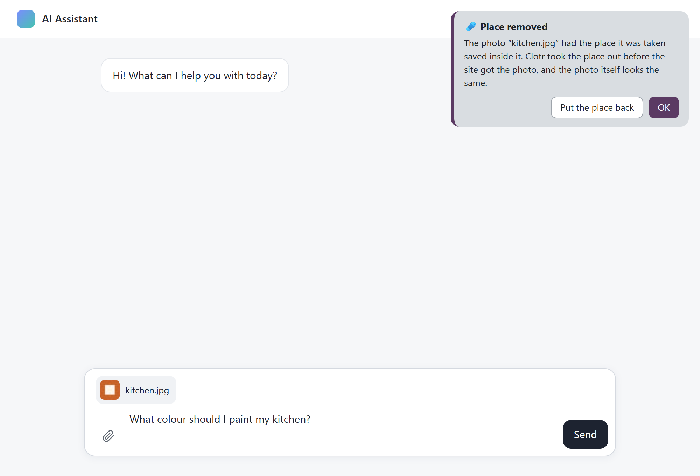

# Clotr

It's far too easy to overshare with AI, and it's going to get easier and easier to leak your private information. I was a mechanic in the Navy, and independently for over a decade,  so I truthfully understand what transparency means. Our privacy is no one else's responsibility than our own, and large companies are never going to take a vested interested in protecting us (especially from AI).

So I started making my own privacy tools to cover my own mistakes. During my shift from mechanics to IT, I leaned on AI early. Due to my mental health I even leaned on in it ways I probably wouldn't lean on a human. After a few months, I started getting intimate details shared back to me in what I thought were 'private' chats. My heart sunk as I realized I was officially giving off 'Dad' energy, and I had no idea the reach of the things I was interacting with.

Clotr is my solution to my problem, ideally implemented for people that don't know any better and those who know too much. I've tried to build it so you could easily set it up for your grandmother. She can go about her regular internet use, and if there's an issue it gives her a clear and private way to communicate with you what's going on (because if you're reading this, you probably know what's going on. Hopefully).

This readme is built from hand. Forgive its gaps.

> Privacy shouldn’t require technical knowledge, expensive tools, or opting out of modern life. It should be the default.
>
> u/monarch-03, on r/privacy

Deciding how you present, and how others see you is a basic human right. The internet, and AI especially, has made it harder than ever to manage what others can see about you. Cybersecurity, and online privacy, should be as simple as wearing sunglasses or choosing where you decide to go in public.

## Install

- [Chrome Web Store](https://chromewebstore.google.com/detail/gkgpgejhhmmhklaghdnbjbalkmpjnmab), which Brave installs from too
- [Firefox Add-ons](https://addons.mozilla.org/firefox/addon/clotr-clot-your-data-leaks/)
- [Microsoft Edge Add-ons](https://microsoftedge.microsoft.com/addons/detail/hbangnmofjeaieaeamlncpcfmhbclbkj)

You can also get the zip from [Releases](https://github.com/clotr-app/clotr/releases), unzip it, and load the folder with Load unpacked on `chrome://extensions` once Developer mode is on.

## What it does

**Clotr catches private details. Like a water line it 'clots' you PII leaks.** It watches the message box on 19 AI chat sites, ChatGPT, Claude and Gemini among them. It spots passwords, keys, card and ID numbers, phone numbers, and addresses,  even when they're spelled out or misspelled (Thank Craigslist spam of Nine 1 Eight ...). It reads the text in files you attach too. When it finds something, a warning shows up in the corner and you pick whether to cover the detail or send it anyway. It only holds a message for the kinds you've set to ask before sending. Quiet warnings on default are the intention, with more aggressive behaviors configurable on setup.

**Clotr tries to warn about scams.** When a message asks for something scammers generally go after like a sign-in code, a card's security code or a gift card number, the warning says who'd really be asking for it. Paste a message you're unsure about into Clotr's "Is this a scam?" page and it marks the warning signs it knows, and says plainly that a message it finds nothing in can still be a scam. This isn't an end all protection, think of it as a cashier at Home Depot asking your grandfather if anyone told him to buy a $1,000 gift card.

**Checks commands you copy.** Copying a command on an AI chat that matches the "verify you're human, paste this" trick gets a warning too, before you ever run it. This one may be clunky, please report any issues or quality of life concerns you have. It helps.

**Practice.** Practice lets you try spotting the signs yourself, in six made-up scam messages and a round of made-up AI chat messages, checked by the same engine that protects you. This one is entirely AI proctored, via my 'inspiration'. Consider practice as just that, practice. An offensive coach never knew the opponents handbook, but they knew and practiced against things that were on the tape.

Email and chat sites like Gmail and Discord stay off until you tick them. Bandage can also swap your name or number for a cover name like `[Phone 1]` before the AI ever sees it.

## How it works

Clotr spots private details with plain pattern matching that anyone can read in `extension/patterns.js`. It works offline, gives the same answer every time, and never talks to an AI service to do it. It reads what you type into the chat box, stores only a short record of what kind of thing it found and on which site/when, and sends none of it anywhere: there's no server and no account, and a test fails the build if anyone adds code that could send data out. Only you can see that record, in Clotr's own Settings. The full details are in [PRIVACY.md](PRIVACY.md), and how well it does on my test set is on [clotr.app](https://clotr.app/how-it-works.html#results-title).

## Permissions

Chrome's install screen lists these by name. Here's what each one is actually for, and what it never does.

| Permission | What Clotr uses it for | What it never does |
| --- | --- | --- |
| `storage` | Keeps your settings, your vault's scrambled entries and a history of what it caught (the kind of thing, the site, the time, your choice) on your own device. | Save the word or number it caught, or send any of that to a server, since there isn't one. |
| `activeTab` | Lets one click on the toolbar icon check whether the site you're on looks like an AI chat worth protecting. | Read any tab you haven't clicked into, or read that same tab again on its own. |
| `scripting` | Starts the checker on a site you've just added, and restarts it in AI chat tabs you already had open after an install or an update. | Run on a site you haven't added yourself. |
| `declarativeContent` | Lights a small dot on the toolbar icon when a page's address matches a known AI chat, so you know there's something to turn on. | Look at anything on the page to decide that. |
| `alarms` | Refreshes the toolbar's "today" count once a day and clears history past the age you chose to keep. | Reach the network. It only sets a timer inside the browser. |
| `nativeMessaging` (optional, not asked for yet) | Held for a feature that isn't switched on yet. | Do anything in this build. Nothing asks you for it until that feature ships. |
| The built-in AI chat sites (`host_permissions`) | Lets Clotr read the message box on the sites listed in `extension/ai-sites.json`, Gemini, ChatGPT, Claude and the rest, so it can check what you're about to send before it goes. | Read a site outside that list unless you add it yourself. |
| `management` (optional, not asked for yet) | Held for a feature that isn't switched on yet. | Do anything in this build. Nothing asks you for it until that feature ships. |
| Any other site (optional `https://*/*`) | Asked for only when you choose to add a site yourself, one at a time from Settings, or all at once with the "Everywhere I type" switch, which stays off until you turn it on. | Get granted when you install Clotr, or reach a site on its own. |

## Free, and staying that way

Clotr is free for everyone, runs on your device, collects nothing and watches nobody. Anything people contribute stays free and open under the same license, and I keep none of the rights to relicense it. If I ever charge for something, it's my own time or a separate tool I wrote myself, never Clotr itself or anyone's code but mine. The promises are in [COMMITMENTS.md](COMMITMENTS.md), and how the project is funded is in [FUNDING.md](FUNDING.md).

## Found a problem?

Open an issue for a false alarm, something it missed, or a bug. Please describe the detail instead of pasting it, something like "a phone number written as five five five…". Security problems go through [SECURITY.md](SECURITY.md).

## Want to help?

I'm the only maintainer, so replies can take a couple days but a first pull request, a missing AI site, or a false alarm with a test is always welcome. You keep your copyright and you sign off each commit; [CONTRIBUTING.md](CONTRIBUTING.md) shows how and lists good first things to try.

## Building it

`npm install`, then `npm test` and `npm run lint`. `npm run test:e2e` drives a real browser with the extension loaded, and `npm run package` builds the release zip. [CONTRIBUTING.md](CONTRIBUTING.md) has the rest, [docs/architecture.md](docs/architecture.md) shows how the parts fit together, and [VERSIONING.md](VERSIONING.md) explains the version numbers.

## License

AGPL-3.0-or-later. If you share a changed version, or run one for other people over a network, you share its source too. Everything people contribute stays under this license. The name and logo aren't covered, so a changed version needs its own. Questions: <support@clotr.app>.
