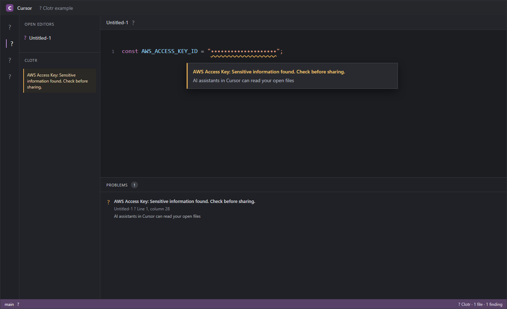

# Clotr for VS Code-compatible editors

I built Clotr for people who code with AI assistants in VS Code, Cursor, Windsurf and VSCodium. It underlines API keys, tokens and passwords in the files you have open, so you know they're there before they end up in a prompt. It names the kind of credential and never shows the value.

Clotr Guard, which you can set up from the extension, goes further: it checks your prompts before they're sent and stops supported assistants from reading secret files such as `.env`.

## Install

Open Extensions with **Ctrl+Shift+X** (Windows/Linux) or **Cmd+Shift+X** (macOS), then search for **Clotr**. If it isn't listed, download the VSIX from [Open VSX](https://open-vsx.org/extension/clotr-app/clotr), open the Command Palette, and choose **Extensions: Install from VSIX...**. These steps work in VS Code-compatible editors.

## Try it

On first use, Clotr shows one dismissible welcome. **Try it** opens an unsaved sample with a made-up key, underlines it and explains the warning. The sample is never saved. No account or network connection is needed.

Clotr checks credentials in open text files up to 1 MiB after a short pause in typing. It skips secret files such as `.env`. Files over 1 MiB and binary files show a warning that Clotr could not check them. Patterns in `clotr.skipList` skip matching files. Personal details are off by default. Findings name the kind of credential without showing its value. The status bar counts checked files and findings, and marks files it could not check.

Quick fixes let you ignore a finding while it stays in place; the ignore clears when the occurrence changes or disappears, the file closes, or the extension reloads. Add a salted fingerprint to `.clotrignore` to skip an exact value, or use **Move to .env** for a supported quoted JavaScript or TypeScript credential. That writes the selected credential to the local `.env` file and updates the source file; review the edits before sharing either file. Use the machine-scoped `clotr.skipList` setting for deliberate file skips. Path patterns in `.clotrignore` do not skip files.

## Clotr Guard

Clotr Guard adds hooks to supported assistants' setup files. After you set it up from the extension, Guard checks prompts before they are sent and stops supported assistants from reading secret files. It detects assistants available on your system, selects one matching your editor when it can, and previews the exact hook changes before you apply them. Setup needs Node.js 20 or newer and a trusted workspace. Clotr works without Guard.

## Local checks

File checks run on this computer. The extension makes no network calls and needs no account. Diagnostics and clipboard results name the kind of finding without showing its value. Workspace state stores a random salt, skipped-file URIs, and whether Clotr showed the workspace secret-file note. Global state stores the one-time welcome choice and Guard update-prompt version. Neither state contains detected values. `.clotrignore` stores salted fingerprints only when you choose to ignore a value. These states stay in local storage and are not registered for Settings Sync; extension settings are machine-scoped.

To check this yourself, disconnect from the network, install Clotr, then choose **Try it**. The warning still appears. You can inspect the extension source and its network rules in the [Clotr repository](https://github.com/clotr-app/clotr).

You can [rate Clotr on Open VSX](https://open-vsx.org/extension/clotr-app/clotr/reviews) or [report a problem](https://github.com/clotr-app/clotr/issues).

## Building it

Build steps are in the repository's [contributing guide](https://github.com/clotr-app/clotr/blob/main/CONTRIBUTING.md#working-on-the-code).
