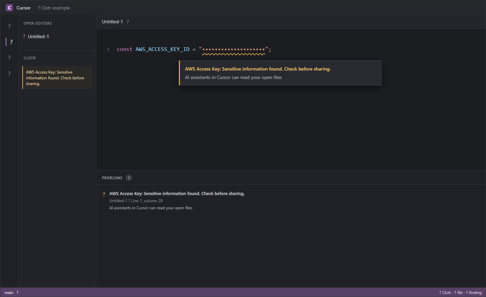

# Clotr for VS Code-compatible editors

Local warnings for credentials in open files that AI coding assistants can read.

I built Clotr for Cursor, Windsurf, VSCodium, and other VS Code-compatible editors. It checks open files as you edit, underlines findings, and says what kind of credential it found. It doesn't show credential values.

## Install

Open Extensions with **Ctrl+Shift+X** (Windows/Linux) or **Cmd+Shift+X** (macOS), then search for **Clotr**. If it isn't in your editor's list, download the VSIX from [Open VSX](https://open-vsx.org/extension/clotr-app/clotr), open the Command Palette, and choose **Extensions: Install from VSIX...**. These steps work in Cursor, Windsurf, and VSCodium.

## Try it

On first use, Clotr shows one dismissible welcome in your editor. Choose **Try it** to open an unsaved sample with a made-up key. Clotr underlines it and explains the warning right away. The sample is never saved. Clotr works without an account or network connection.

Clotr checks credentials in open text files up to 1 MiB, after a short pause in typing. Secret files such as `.env` stay quiet. Files over 1 MiB and binary files show a warning that Clotr could not check them. Patterns in `clotr.skipList` skip matching files. Personal details are off by default. Each finding names its kind without showing the detected value. The status bar counts checked files and findings, and marks files it could not check.

The quick fixes let you ignore that occurrence while it stays in the same place in the file; the ignore clears when the occurrence changes or disappears, the file closes, or the extension reloads. You can also add a salted fingerprint to `.clotrignore`, or use **Move to .env** for a supported quoted JavaScript/TypeScript credential. The last action writes the selected credential to the local `.env` file and updates the source file; review the edit before sharing either file. Path patterns in `.clotrignore` do not skip files; fingerprints skip exact values. Use the machine-scoped `clotr.skipList` setting for deliberate file skips.

## Clotr Guard

Clotr Guard adds hooks to supported assistants' existing setup files so it can check prompts before they are sent. **Set up Clotr Guard for AI coding assistants** detects assistants available on your system, selects the one matching your editor when possible, and previews the exact Clotr hook changes before you apply them. Guard needs Node.js 20 or newer and a trusted workspace. The extension also works without Guard.

## Local checks

File checks run on this computer. The extension makes no network calls and needs no account. Diagnostic text and clipboard results identify the kind of finding without including its value. Workspace state stores a random salt, skipped-file URIs, and whether Clotr showed the workspace secret-file note. Global state stores the one-time welcome choice and Guard update-prompt version. Neither state contains detected values. `.clotrignore` stores salted fingerprints only when you choose to ignore a value. These extension states stay in local storage and are not registered for Settings Sync; the extension's settings are machine-scoped.

To check this yourself, disconnect from the network, install Clotr, then choose **Try it**. The warning still appears. You can also inspect the extension's source and its network rules in the [Clotr repository](https://github.com/clotr-app/clotr).

You can [rate Clotr on Open VSX](https://open-vsx.org/extension/clotr-app/clotr/reviews) or [report a problem](https://github.com/clotr-app/clotr/issues).

## Building it

Build steps are in the repository's [contributing guide](https://github.com/clotr-app/clotr/blob/main/CONTRIBUTING.md#working-on-the-code).
